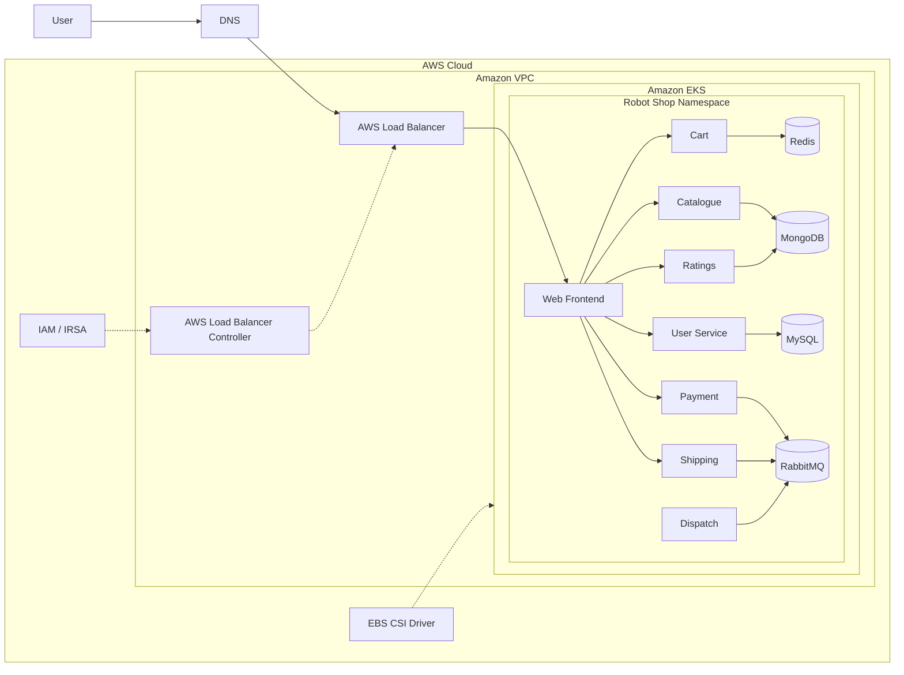

##  Project Overview
## Three Tier Architecture Deployment on AWS EKS

This project demonstrates the deployment of **Stan's Robot Shop**, a sample microservices-based e-commerce application, on **Amazon Elastic Kubernetes Service (Amazon EKS)**.

The application is containerized with Docker and orchestrated using Kubernetes. Helm is used to package and deploy the application components. AWS integration includes EKS cluster identity and IAM configuration, the AWS Load Balancer Controller, and optional EBS CSI support for persistent storage.

The repository also contains Kubernetes manifests and supporting deployment documentation for experimenting with cloud-native application operations.

This sample microservice application has been built using these technologies:
- NodeJS ([Express](http://expressjs.com/))
- Java ([Spring Boot](https://spring.io/))
- Python ([Flask](http://flask.pocoo.org))
- Golang
- PHP (Apache)
- MongoDB
- Redis
- MySQL ([Maxmind](http://www.maxmind.com) data)
- RabbitMQ
- Nginx
- AngularJS (1.x)
# AWS EKS – Three-Tier Robot Shop Microservices

<p align="center">
  <b>Cloud-Native Microservices Deployment on Amazon EKS</b><br/>
  Kubernetes • Helm • AWS • Docker • IAM • AWS Load Balancing
</p>

<p align="center">
  
  
  
  
  
</p>


##  Architecture

The application is organized into three logical tiers:

1. **Presentation tier** – The web frontend receives browser requests.
2. **Application tier** – Backend microservices handle catalogue, cart, user, payment, shipping, dispatch, and ratings functions.
3. **Data and messaging tier** – MongoDB, MySQL, Redis, and RabbitMQ provide persistence, caching, and messaging.

### High-level AWS and Kubernetes architecture



*The diagram is a logical overview. Actual traffic paths and AWS resources depend on the selected Service/Ingress configuration and the resources provisioned in your AWS account.*

### Request flow

1. A user opens the Robot Shop application using its public endpoint.
2. The AWS load balancer forwards traffic to the Kubernetes web service.
3. The frontend communicates with the backend microservices through Kubernetes Services and cluster networking.
4. Backend services communicate with the required databases, cache, and message broker.
5. Kubernetes manages container scheduling, service discovery, and workload recovery.

##  Technology Stack

| Area | Technologies |
|---|---|
| Cloud | AWS |
| Managed Kubernetes | Amazon EKS |
| Containerization | Docker |
| Orchestration | Kubernetes |
| Application packaging | Helm |
| Cluster access | AWS CLI, `kubectl`, `eksctl` |
| Load balancing | AWS Load Balancer Controller, ALB/LoadBalancer resources |
| Identity and access | AWS IAM, EKS OIDC / workload IAM |
| Persistent storage | Amazon EBS CSI Driver (when enabled and required) |
| Application components | Node.js, Java, Python, Go, PHP |
| Data and messaging | MongoDB, MySQL, Redis, RabbitMQ |
| Automation examples | GitHub Actions workflow files |

##  Microservices

The Robot Shop application consists of the following components:

| Component | Responsibility |
|---|---|
| `web` | Web storefront / frontend |
| `cart` | Shopping cart operations |
| `catalogue` | Product catalogue |
| `user` | User-related operations |
| `payment` | Payment simulation |
| `shipping` | Shipping calculations / operations |
| `dispatch` | Dispatch processing |
| `ratings` | Product ratings |
| `mongodb` | Document database used by application services |
| `mysql` | Relational database |
| `redis` | Cache / data store |
| `rabbitmq` | Message broker |

## 📂 Repository Structure

```text
aws-eks-three-tier-robot-shop/
│
├── EKS/
│   ├── 01-prerequisites.md
│   ├── 02-eks-cluster-setup.md
│   ├── 03-oidc-IAM.md
│   ├── 04-alb-configuration.md
│   ├── 05-ebs-csi-driver.md
│   └── helm/
│       ├── Chart.yaml
│       ├── values.yaml
│       ├── ingress.yaml
│       └── templates/
│           ├── *-deployment.yaml
│           ├── *-service.yaml
│           └── ...
│
├── K8s/
│   ├── helm/
│   ├── Istio/
│   └── README.md
│
├── .github/
│   └── workflows/
│
├── DCOS/
├── fluentd/
├── load-gen/
├── docker-compose.yaml
└── README.md
```

- `EKS/` – EKS prerequisites, cluster/IAM/load-balancer/storage guidance, and the EKS Helm chart.
- `EKS/helm/` – Helm chart and Kubernetes templates for Robot Shop.
- `K8s/` – General Kubernetes deployment assets, Helm chart, and Istio examples.
- `.github/workflows/` – GitHub Actions workflow examples. Review and configure these before relying on them.
- `load-gen/` – Optional load-generation utility.
- `fluentd/` – Optional logging integration examples.
- `DCOS/` – DC/OS deployment manifests.

##  Prerequisites

Before deploying, make sure you have:

- An AWS account with permission to create and manage EKS and the required supporting resources.
- AWS CLI configured with the intended AWS profile and region.
- `kubectl`
- `eksctl`
- Helm 3
- Docker (optional, if building or testing images)
- An existing EKS cluster, or the resources and permissions required to create one.

Check the tools:

```bash
aws --version
kubectl version --client
eksctl version
helm version
docker --version
```

Configure and verify AWS credentials:

```bash
aws configure
aws sts get-caller-identity
```

Set your cluster variables. Replace the example values with your own:

```bash
export AWS_REGION=ap-south-1
export CLUSTER_NAME=<your-eks-cluster-name>
```

Connect `kubectl` to the cluster:

```bash
aws eks update-kubeconfig \
  --region "$AWS_REGION" \
  --name "$CLUSTER_NAME"

kubectl get nodes
kubectl get namespaces
```

##  Deployment Guide

> The commands below are a deployment outline. Use the detailed guides in [`EKS/`](EKS/) and adapt cluster creation, node capacity, IAM, networking, and storage settings to your AWS account. EKS and supporting AWS resources can incur charges.

### 1. Prepare the EKS cluster

If you are creating a new cluster, follow [`EKS/01-prerequisites.md`](EKS/01-prerequisites.md) and [`EKS/02-eks-cluster-setup.md`](EKS/02-eks-cluster-setup.md).

For an existing cluster, configure the kubeconfig as shown above and verify that the worker nodes are `Ready`.

### 2. Configure IAM OIDC for workload permissions

Follow [`EKS/03-oidc-IAM.md`](EKS/03-oidc-IAM.md). The repository documents associating an IAM OIDC provider with the EKS cluster.

```bash
eksctl utils associate-iam-oidc-provider \
  --cluster "$CLUSTER_NAME" \
  --region "$AWS_REGION" \
  --approve
```

Only create IAM roles and policies that are required. Check whether they already exist before creating duplicates.

### 3. Install the AWS Load Balancer Controller (if using AWS-managed load balancing)

Follow [`EKS/04-alb-configuration.md`](EKS/04-alb-configuration.md) and the official AWS documentation for the controller version you use.

The controller requires a compatible IAM policy and service account. Configure the correct cluster name, AWS region, VPC ID, and IAM role.

Verify the controller:

```bash
kubectl get deployment \
  -n kube-system \
  aws-load-balancer-controller

kubectl get pods -n kube-system
```

### 4. Configure persistent storage (if required)

If your selected workloads need persistent EBS volumes, follow [`EKS/05-ebs-csi-driver.md`](EKS/05-ebs-csi-driver.md).

Verify the CSI components and storage classes:

```bash
kubectl get pods -n kube-system | grep ebs
kubectl get storageclass
```

### 5. Deploy Robot Shop using Helm

From the repository root:

```bash
kubectl create namespace robot-shop
```

If the namespace already exists, Kubernetes will report that; continue without recreating it.

Install the chart:

```bash
helm upgrade --install robot-shop ./EKS/helm \
  --namespace robot-shop
```

Check the Helm release and Kubernetes resources:

```bash
helm list -n robot-shop
kubectl get all -n robot-shop
kubectl get pods -n robot-shop -o wide
kubectl get services -n robot-shop
```

Wait for workloads to become ready:

```bash
kubectl rollout status deployment --all -n robot-shop
```

Some components may use StatefulSets, so inspect those separately:

```bash
kubectl get statefulsets -n robot-shop
kubectl get pvc -n robot-shop
```

### 6. Configure application access

The chart's `web` Service template uses `LoadBalancer` by default (`nodeport: false`). The repository also contains an ALB Ingress manifest at [`EKS/helm/ingress.yaml`](EKS/helm/ingress.yaml).

Choose and configure the exposure method that matches your cluster:

- **Service type `LoadBalancer`:** Kubernetes requests an AWS load balancer for the Service. This requires AWS account support, suitable networking, and the appropriate controller/integration.
- **ALB Ingress:** Apply and configure the Ingress with the AWS Load Balancer Controller. Ensure the backend Service type and Ingress settings are appropriate for the controller's target mode.

Do not assume that both methods are required. Avoid creating duplicate public load balancers unintentionally.

Inspect the endpoint:

```bash
kubectl get svc web -n robot-shop
kubectl get ingress -n robot-shop
kubectl describe svc web -n robot-shop
kubectl describe ingress robot-shop -n robot-shop
```

When the load balancer has provisioned successfully, use its DNS name in a browser:

```text
http://<load-balancer-dns-name>
```

For a temporary in-cluster/local test that does not require a public load balancer, use port forwarding:

```bash
kubectl port-forward -n robot-shop svc/web 8080:8080
```

Then open `http://localhost:8080`.

##  Validation and Troubleshooting

Useful commands when validating the deployment:

```bash
# Cluster and nodes
kubectl get nodes -o wide
kubectl cluster-info

# Application workloads
kubectl get pods -n robot-shop -o wide
kubectl get deployments -n robot-shop
kubectl get statefulsets -n robot-shop

# Services, endpoints and ingress
kubectl get svc -n robot-shop
kubectl get endpoints -n robot-shop
kubectl get ingress -n robot-shop

# Events and detailed pod information
kubectl get events -n robot-shop --sort-by=.lastTimestamp
kubectl describe pod <pod-name> -n robot-shop

# Application logs
kubectl logs <pod-name> -n robot-shop
kubectl logs deployment/<deployment-name> -n robot-shop

# Helm release
helm status robot-shop -n robot-shop
helm get values robot-shop -n robot-shop
```

Common issues to investigate:

| Symptom | What to check |
|---|---|
| Pods remain `Pending` | Node capacity, CPU/memory requests, node selectors, taints, and PVC binding |
| Pods show `ImagePullBackOff` | Image name/tag, registry access, and image pull secrets |
| Service has no endpoints | Pod readiness, Service selector, and matching pod labels |
| Load balancer is not created | AWS account permissions/service availability, subnet tags, IAM permissions, controller logs, and Kubernetes events |
| PVC remains `Pending` | EBS CSI driver, StorageClass, IAM permissions, and availability zone constraints |
| Application returns errors | Pod logs, service DNS, dependency readiness, and application configuration |

For load balancer failures, inspect the controller logs and Kubernetes events:

```bash
kubectl logs deployment/aws-load-balancer-controller \
  -n kube-system --tail=100

kubectl get events -A --sort-by=.lastTimestamp
```


**Important:** Deleting an EKS cluster does not always mean every separately created AWS resource has been removed. Review the AWS Console and billing dashboard after teardown.

##  Cleanup

If the cluster was created and managed by `eksctl`, the following command can delete the cluster and resources managed as part of that cluster configuration:

```bash
eksctl delete cluster \
  --name "$CLUSTER_NAME" \
  --region "$AWS_REGION"
```

This is a destructive operation. Confirm the cluster name and region first, and back up any data you need.

After deletion, review separately managed resources such as IAM roles and policies, load balancers, NAT Gateways, Elastic IP addresses, EBS volumes, and CloudFormation stacks. Delete only resources that belong to this project and are no longer needed.

##  Useful References

- [Amazon EKS Documentation](https://docs.aws.amazon.com/eks/)
- [Kubernetes Documentation](https://kubernetes.io/docs/)
- [Helm Documentation](https://helm.sh/docs/)
- [AWS Load Balancer Controller](https://kubernetes-sigs.github.io/aws-load-balancer-controller/)
- [Amazon EBS CSI Driver](https://docs.aws.amazon.com/eks/latest/userguide/ebs-csi.html)

##  Author
# Irfan Ahmad (DevOps Engineer) 


**Project URL:** [aws-eks-three-tier-robot-shop](https://github.com/Irfan-devops1/aws-eks-three-tier-robot-shop)
- GitHub: [Irfan-devops1](https://github.com/Irfan-devops1)
---

# If you find this project useful for learning AWS, Kubernetes, and DevOps practices, feel free to star the repository.

